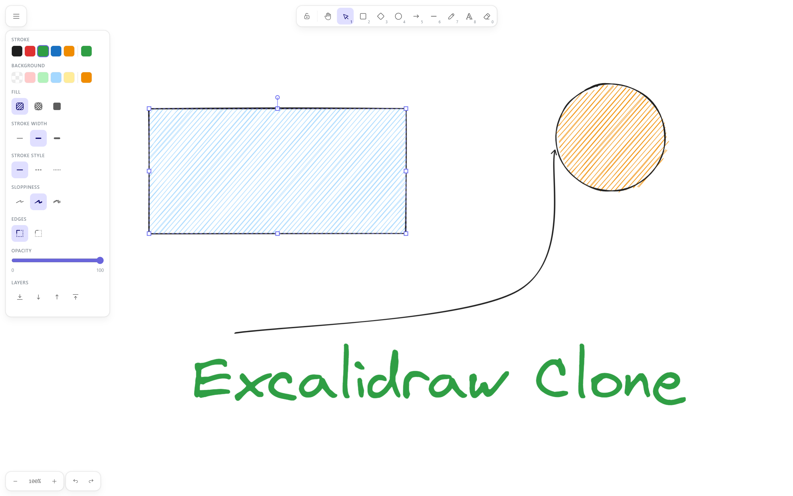

# Excalidraw Clone

A feature-rich clone of [Excalidraw](https://excalidraw.com), built from scratch and running entirely in the browser with no backend.

 

  

## Features

- **10 drawing tools** — Hand, Select, Rectangle, Diamond, Ellipse, Arrow, Line, Freedraw, Text, Eraser
- **Style controls** — Stroke color, background color, fill style, stroke width, stroke style, sloppiness, edge rounding, opacity
- **Text tool** — Three font families (Virgil hand-drawn, Normal, Cascadia code), four sizes, three alignments
- **Arrow options** — Sharp, curved, or elbow routing; arrowhead styles
- **Layer management** — Send to back/forward, bring to front/backward
- **Undo / Redo** — Full history (up to 100 steps)
- **Pan & Zoom** — Scroll wheel, pinch, or zoom controls; Ctrl+scroll
- **Dark / Light / System theme**
- **Canvas backgrounds** — White, Slate, Blue, Yellow, Bronze
- **Keyboard shortcuts** — H, V/1–8, E/0, Q (lock), Ctrl+Z/Y, Delete, Escape
- **Persistent canvas** — Drawing auto-saved to localStorage; survives page refresh
- **Responsive** — Floating island toolbar on desktop (top-center), scrollable bottom island on mobile

## Tech Stack

| Category  | Tech                                                                |
| --------- | ------------------------------------------------------------------- |
| Framework | [React 19](https://react.dev) + TypeScript                          |
| Build     | [Vite 8](https://vitejs.dev)                                        |
| Styles    | [Tailwind CSS v4](https://tailwindcss.com)                          |
| Shapes    | [Rough.js](https://roughjs.com)                                     |
| Freedraw  | [Perfect Freehand](https://github.com/steveruizok/perfect-freehand) |
| Fonts     | Virgil (hand-drawn), Cascadia Code (monospace)                      |
